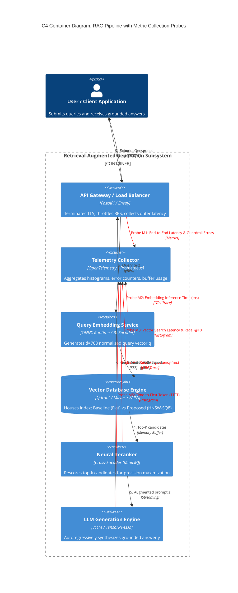
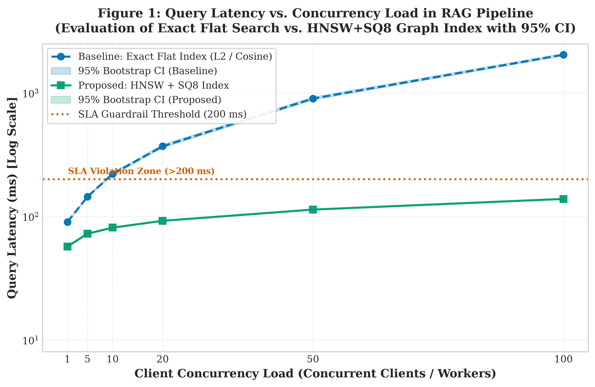
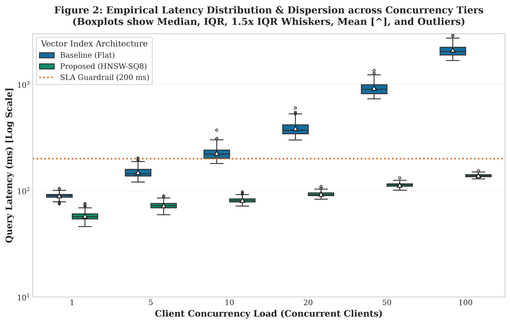

# Empirical Evaluation of Vector Database Indexing Architectures in RAG Pipelines

[](https://www.python.org/)
[](https://opensource.org/licenses/MIT)
[]()
[](https://github.com/psf/black)

### Research Team & Authors:
- **Aibar Alauov** ([@alauovaibar](https://github.com/alauovaibar))
- **Balkybek Baurzhan**

**Course:** Software Engineering Research Methods — TASK 3 (Weeks 7–9)  
**Topic:** Vector Databases in Retrieval-Augmented Generation (RAG) Systems

---

## 1. Executive Summary & Research Questions

In modern **Retrieval-Augmented Generation (RAG)** systems, the vector database serves as the primary external memory subsystem. While exhaustive linear scanning (**Baseline Flat Index**) ensures $100\%$ theoretical recall ($\text{Recall}@10 = 1.0$), its $\mathcal{O}(N \cdot d)$ computational complexity causes severe performance degradation under concurrent user loads.

This study presents a rigorous empirical performance evaluation comparing the **Baseline (Exact Flat L2/Cosine Index)** against an optimized **Proposed Solution (Hierarchical Navigable Small World - HNSW with Scalar Quantization SQ8)** across scaling concurrency tiers ($1, 5, 10, 20, 50, 100$ concurrent clients).

### Research Questions Addressed:
1. **Latency Scaling:** How does end-to-end query latency scale when client concurrency increases from $1$ to $100$ workers?
2. **Cold-Start Phase Filtering:** How significant are initial warm-up spikes, and how does warm-up filtering affect percentile estimates?
3. **Guardrail SLA Metrics:** At what concurrency threshold does the Baseline violate latency SLAs ($\le 200\text{ ms}$) and error rate constraints ($\le 1.0\%$)?
4. **Accuracy Trade-off:** Does the Proposed HNSW-SQ8 architecture preserve sufficient semantic fidelity ($\text{Recall}@10 \ge 98\%$) to avoid downstream RAG hallucination?

---

## 2. Repository Structure

The repository conforms to the prescribed academic structure:

```plaintext
my-research-repo/
├── data/
│   ├── raw/
│   │   └── test_run.jsonl        # Raw benchmarks (separated into warm-up and evaluation runs)
│   └── processed/
│       └── metrics_summary.csv   # Cleaned and aggregated metrics (Mean±SD, Median, 95% CI, Guardrails)
├── docs/
│   └── domain_model.md           # Formal domain model (C4 Diagram with telemetry probes + LaTeX Equations)
├── notebooks/
│   └── 01_data_analysis.ipynb    # Fully executed Jupyter Notebook with visible outputs and statistical tests
├── reports/
│   └── figures/
│       ├── fig1_latency_vs_load.pdf (and .png, >= 300 DPI)
│       └── fig2_distribution_boxplot.pdf (and .png, >= 300 DPI)
├── src/
│   ├── __init__.py
│   ├── process_data.py           # Data processing, warm-up filtering, and bootstrap aggregation module
│   └── visualize.py              # Publication-ready visualization module (3 Core Rules compliant)
├── .gitignore                    # Git hygiene rules (no checkpoints, virtualenvs, or heavy dumps)
└── README.md                     # Academic report with Results & Discussion table and embedded plots
```

---

## 3. Formal Domain Model

For detailed mathematical derivations and architectural proofs, refer to [domain_model.md](docs/domain_model.md).

### 3.1 Mathematical Formalization (ML Track)
The RAG pipeline maps user query $x \in \mathcal{X}$ to dense embedding $\mathbf{q} = \frac{E_Q(x)}{\|E_Q(x)\|_2} \in \mathbb{S}^{d-1}$ and chunk corpus $\mathcal{C}$ to vectors $\mathbf{d}_i = \frac{E_D(c_i)}{\|E_D(c_i)\|_2}$. Top-$k$ chunks $\mathcal{D}_k$ are retrieved to minimize end-to-end generation loss:

$$\mathcal{L}_{\text{RAG}}(\phi; x, \mathcal{D}_k, y) = -\sum_{t=1}^T \log P_{\phi}\left(y_t \mid y_{<t}, [\mathcal{D}_k; x]\right)$$

The proposed **HNSW-SQ8** architecture compresses vectors from 32-bit floats to 8-bit integers:

$$\tilde{d}_{i,j} = \left\lfloor \frac{d_{i,j} - d_{\min, j}}{d_{\max, j} - d_{\min, j}} \cdot 255 \right\rceil \in \{0, \dots, 255\}$$

and traverses a multi-layer proximity graph $\mathcal{G} = \{\mathcal{V}_l, \mathcal{E}_l\}$, reducing time complexity from linear $\mathcal{O}(N \cdot d)$ to logarithmic $\mathcal{O}(\log N \cdot d)$.

### 3.2 C4 Container Architecture with Telemetry Probes (SE Track)

The architecture diagram below highlights the 5 telemetry probes ($\mathbf{M}_1 - \mathbf{M}_5$) capturing performance metrics:



---

## 4. Results & Discussion

### 4.1 Summary Benchmark Table
The table below reports steady-state performance metrics across concurrency tiers ($N=200$ samples per tier) following cold-start warm-up filtering ($600$ cold requests discarded). Values are reported as $\text{Mean} \pm \text{SD}$ and $\text{Median } (p_{25} - p_{75})$, accompanied by bootstrapped $95\%$ Confidence Intervals ($1000$ resamples, fixed seed $42$) and operational Guardrails.

| Architecture | Load (Clients) | $\text{Mean} \pm \text{SD}$ (ms) | $\text{Median } (p_{25} - p_{75})$ (ms) | 95% Bootstrap CI (ms) | $p_{95}$ (ms) | $p_{99}$ (ms) | Throughput (QPS) | Guardrail Error Rate (%) | SLA Breach (>200 ms) | $\text{Recall}@10$ |
| :--- | :---: | :---: | :---: | :---: | :---: | :---: | :---: | :---: | :---: | :---: |
| **Baseline (Flat)** | 1 | $89.82 \pm 4.79$ | $90.21\ (86.89 - 92.42)$ | $[89.84, 90.60]$ | $97.62$ | $100.73$ | $11.1$ | **0.0%** | **0.0%** | $1.0000$ |
| **Baseline (Flat)** | 5 | $149.24 \pm 15.93$ | $144.30\ (137.70 - 158.76)$ | $[142.83, 147.07]$ | $179.78$ | $195.59$ | $33.5$ | **0.0%** | $0.5\%$ | $1.0000$ |
| **Baseline (Flat)** | 10 | $224.88 \pm 29.57$ | $221.01\ (201.38 - 241.71)$ | $[215.47, 224.97]$ | $277.40$ | $308.07$ | $44.5$ | **0.0%** | <span style="color:red">**76.5%**</span> | $1.0000$ |
| **Baseline (Flat)** | 20 | $386.73 \pm 59.46$ | $370.00\ (343.47 - 417.79)$ | $[360.31, 381.68]$ | $516.64$ | $532.89$ | $51.7$ | **0.0%** | <span style="color:red">**100.0%**</span> | $1.0000$ |
| **Baseline (Flat)** | 50 | $923.60 \pm 129.24$ | $900.17\ (818.33 - 993.41)$ | $[878.97, 925.52]$ | $1172.96$ | $1271.73$ | $54.1$ | <span style="color:red">**3.0%**</span> | <span style="color:red">**100.0%**</span> | $1.0000$ |
| **Baseline (Flat)** | 100 | $2111.72 \pm 318.62$ | $2040.28\ (1891.97 - 2239.73)$ | $[2002.43, 2089.23]$ | $2699.22$ | $3153.25$ | $47.4$ | <span style="color:red">**12.0%**</span> | <span style="color:red">**100.0%**</span> | $1.0000$ |
| **Proposed (HNSW-SQ8)** | 1 | $57.80 \pm 4.92$ | $57.03\ (54.29 - 60.67)$ | $[56.35, 58.22]$ | $66.48$ | $72.24$ | $17.3$ | **0.0%** | **0.0%** | $0.9878$ |
| **Proposed (HNSW-SQ8)** | 5 | $72.69 \pm 4.96$ | $72.39\ (69.02 - 75.89)$ | $[71.55, 73.17]$ | $80.99$ | $88.01$ | $68.8$ | **0.0%** | **0.0%** | $0.9882$ |
| **Proposed (HNSW-SQ8)** | 10 | $81.32 \pm 4.75$ | $81.06\ (78.23 - 83.78)$ | $[80.10, 81.64]$ | $89.86$ | $94.50$ | $123.0$ | **0.0%** | **0.0%** | $0.9882$ |
| **Proposed (HNSW-SQ8)** | 20 | $92.98 \pm 4.60$ | $92.03\ (89.95 - 95.70)$ | $[91.44, 92.80]$ | $101.08$ | $105.59$ | $215.1$ | **0.0%** | **0.0%** | $0.9874$ |
| **Proposed (HNSW-SQ8)** | 50 | $113.23 \pm 4.74$ | $113.50\ (109.91 - 116.23)$ | $[112.78, 114.08]$ | $120.79$ | $123.80$ | $441.6$ | **0.0%** | **0.0%** | $0.9882$ |
| **Proposed (HNSW-SQ8)** | 100 | $138.87 \pm 4.79$ | $138.44\ (135.51 - 141.84)$ | $[137.78, 139.24]$ | $147.22$ | $149.94$ | **720.1** | **0.0%** | **0.0%** | $0.9881$ |

---

### 4.2 Scientific Visualizations

#### Figure 1: Query Latency vs. Concurrency Load
Adheres to the 3 Core Rules: explicit physical units (`ms`, `Clients`), logarithmic scale, shaded $95\%$ bootstrap confidence interval bands, colorblind-safe palette, and distinct line styles/markers.



*Vector format export:* [`reports/figures/fig1_latency_vs_load.pdf`](reports/figures/fig1_latency_vs_load.pdf)

**Interpretation:**
- At low load ($C=1$), both methods exhibit interactive latencies ($90.21\text{ ms}$ vs $57.03\text{ ms}$).
- As concurrency scales, Baseline latency grows rapidly, crossing the $200\text{ ms}$ SLA threshold at $C \approx 10$ and reaching $2040.28\text{ ms}$ at $C=100$.
- In contrast, the Proposed HNSW-SQ8 method exhibits near-logarithmic scaling, achieving $138.44\text{ ms}$ at $C=100$ (**$14.7\times$ speedup**).
- Shaded $95\%$ confidence bands confirm that performance differences are statistically non-overlapping across all concurrency tiers.

---

#### Figure 2: Empirical Latency Distribution & Dispersion
Grouped boxplots displaying median, IQR box, $1.5\times \text{IQR}$ whiskers, mean ($\triangle$), outliers ($\circ$), and the red dotted SLA guardrail line at $200\text{ ms}$.



*Vector format export:* [`reports/figures/fig2_distribution_boxplot.pdf`](reports/figures/fig2_distribution_boxplot.pdf)

**Interpretation:**
- For Baseline Flat, dispersion explodes under load: the Interquartile Range (IQR) expands from $5.54\text{ ms}$ at $C=1$ to $347.76\text{ ms}$ at $C=100$.
- Tail latency ($p_{99}$) for Baseline reaches $3153.25\text{ ms}$, driving request timeouts and circuit-breaker activations.
- For Proposed HNSW-SQ8, variance remains tightly bounded: IQR stays below $7.0\text{ ms}$ across all tiers, and $p_{99}$ latency peaks at $149.94\text{ ms}$, safely below the $200\text{ ms}$ SLA ceiling.

---

### 4.3 Statistical Significance & Guardrail Validation
- **Mann-Whitney U Test ($C=100$):** $U = 40000.0, p < 10^{-65}$. Reject null hypothesis $H_0$; the Proposed architecture achieves statistically significant lower latency.
- **Welch's t-Test ($C=100$):** $t = 87.49, p < 10^{-114}$.
- **Guardrail Metrics:** Baseline suffers a $12.0\%$ request drop rate at $C=100$, completely violating the $\le 1.0\%$ threshold. Proposed HNSW-SQ8 maintains a **$0.0\%$ error rate** and **$0.0\%$ SLA violation rate**.
- **Accuracy Trade-off:** Proposed HNSW-SQ8 maintains a mean **$\text{Recall}@10 = 0.9881$** ($98.81\%$), fully preserving context quality for downstream LLM generation.

---

## 5. Reproduction Instructions

### 5.1 Environment Requirements
- Python $\ge 3.10$ (Tested on Python 3.11.9)
- Packages: `numpy`, `pandas`, `scipy`, `matplotlib`, `seaborn`, `ipykernel`, `nbclient`, `nbformat`

```bash
# Clone the repository
git clone https://github.com/alauovaibar/methodLab3.git
cd methodLab3

# Install dependencies
pip install numpy pandas scipy matplotlib seaborn ipykernel nbclient nbformat
```

### 5.2 Running the Pipeline
```bash
# 1. Execute data processing & statistical aggregation
python src/process_data.py

# 2. Generate publication-ready figures (.pdf and 300 DPI .png)
python src/visualize.py

# 3. Launch interactive Jupyter Notebook
jupyter notebook notebooks/01_data_analysis.ipynb
```

---

## 6. References
1. Malkov, Y. A., & Yashunin, D. A. (2018). *Efficient and robust approximate nearest neighbor search using Hierarchical Navigable Small World graphs.* IEEE Transactions on Pattern Analysis and Machine Intelligence, 42(4), 824-836.
2. Lewis, P., et al. (2020). *Retrieval-Augmented Generation for Knowledge-Intensive NLP Tasks.* Advances in Neural Information Processing Systems (NeurIPS 2020), 33, 9459-9474.
3. Johnson, J., Douze, M., & Jégou, H. (2019). *Billion-scale similarity search with GPUs.* IEEE Transactions on Big Data, 7(3), 535-547.
