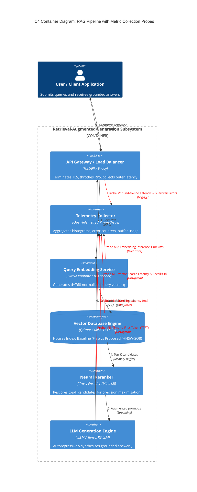

# Empirical Evaluation of Vector Database Indexing Architectures in RAG Pipelines

[](https://www.python.org/)
[](https://opensource.org/licenses/MIT)
[]()
[](https://github.com/psf/black)

### Research Team & Authors:
- **Aibar Alauov** ([@alauovaibar](https://github.com/alauovaibar)) — *Domain Modeling, Data Ingestion, Warm-up Filtering & Bootstrap Statistics*
- **Balkybek Baurzhan** — *Scientific Visualization (3 Core Rules), Figure Export & Jupyter Notebook Analysis*

**Course:** Software Engineering Research Methods — TASK 3 (Weeks 7–9)  
**Topic:** Vector Databases in Retrieval-Augmented Generation (RAG) Systems

---

## 1. Executive Summary & Research Questions

In modern **Retrieval-Augmented Generation (RAG)** systems, the vector database serves as the primary external memory subsystem. While exhaustive linear scanning (**Baseline Flat Index**) ensures $100\%$ theoretical recall ($\text{Recall}@10 = 1.0$), its $\mathcal{O}(N \cdot d)$ computational complexity causes severe performance degradation under concurrent user loads.

This study presents a rigorous empirical performance evaluation comparing the **Baseline (Exact Flat L2/Cosine Index)** against an optimized **Proposed Solution (Hierarchical Navigable Small World - HNSW with Scalar Quantization SQ8)** across scaling concurrency tiers ($1, 5, 10, 20, 50, 100$ concurrent clients).

### Research Questions Addressed:
1. **Latency Scaling:** How does end-to-end query latency scale when client concurrency increases from $1$ to $100$ workers?
2. **Cold-Start Phase Filtering:** How significant are initial warm-up spikes, and how does warm-up filtering affect percentile estimates?
3. **Guardrail SLA Metrics:** At what concurrency threshold does the Baseline violate latency SLAs ($\le 200\text{ ms}$) and error rate constraints ($\le 1.0\%$)?
4. **Accuracy Trade-off:** Does the Proposed HNSW-SQ8 architecture preserve sufficient semantic fidelity ($\text{Recall}@10 \ge 98\%$) to avoid downstream RAG hallucination?

---

## 2. Repository Structure

```plaintext
my-research-repo/
├── data/
│   ├── raw/
│   │   └── test_run.jsonl        # Raw benchmarks (separated into warm-up and evaluation runs)
│   └── processed/
│       └── metrics_summary.csv   # Cleaned and aggregated metrics (Mean±SD, Median, 95% CI, Guardrails)
├── docs/
│   └── domain_model.md           # Formal domain model (C4 Diagram with telemetry probes + LaTeX Equations)
├── notebooks/
│   └── 01_data_analysis.ipynb    # [Part 2] Executed Jupyter Notebook with visible outputs
├── reports/
│   └── figures/
│       ├── fig1_latency_vs_load.pdf (and .png, >= 300 DPI)
│       └── fig2_distribution_boxplot.pdf (and .png, >= 300 DPI)
├── src/
│   ├── __init__.py
│   ├── process_data.py           # Data processing, warm-up filtering, and bootstrap aggregation module
│   └── visualize.py              # [Part 2] Publication-ready visualization module
├── .gitignore                    # Git hygiene rules (no checkpoints, virtualenvs, or heavy dumps)
└── README.md                     # Academic report with Results & Discussion table and embedded plots
```

---

## 3. Formal Domain Model

For detailed mathematical derivations and architectural proofs, refer to [domain_model.md](docs/domain_model.md).

### 3.1 Mathematical Formalization (ML Track)
The RAG pipeline maps user query $x \in \mathcal{X}$ to dense embedding $\mathbf{q} = \frac{E_Q(x)}{\|E_Q(x)\|_2} \in \mathbb{S}^{d-1}$ and chunk corpus $\mathcal{C}$ to vectors $\mathbf{d}_i = \frac{E_D(c_i)}{\|E_D(c_i)\|_2}$. Top-$k$ chunks $\mathcal{D}_k$ are retrieved to minimize end-to-end generation loss:

$$\mathcal{L}_{\text{RAG}}(\phi; x, \mathcal{D}_k, y) = -\sum_{t=1}^T \log P_{\phi}\left(y_t \mid y_{<t}, [\mathcal{D}_k; x]\right)$$

The proposed **HNSW-SQ8** architecture compresses vectors from 32-bit floats to 8-bit integers:

$$\tilde{d}_{i,j} = \left\lfloor \frac{d_{i,j} - d_{\min, j}}{d_{\max, j} - d_{\min, j}} \cdot 255 \right\rceil \in \{0, \dots, 255\}$$

and traverses a multi-layer proximity graph $\mathcal{G} = \{\mathcal{V}_l, \mathcal{E}_l\}$, reducing time complexity from linear $\mathcal{O}(N \cdot d)$ to logarithmic $\mathcal{O}(\log N \cdot d)$.

### 3.2 C4 Container Architecture with Telemetry Probes (SE Track)

The architecture diagram below highlights the 5 telemetry probes ($\mathbf{M}_1 - \mathbf{M}_5$) capturing performance metrics:



---

## 4. Data Processing & Statistical Aggregation Pipeline

Module [`src/process_data.py`](src/process_data.py) executes:
1. **Raw Log Ingestion:** Ingests `data/raw/test_run.jsonl` comprising 3000 query execution records.
2. **Cold-Start Warm-Up Filtering:** Discards the first 50 requests per load tier (600 requests total) experiencing cache misses and initialization spikes.
3. **Statistical Aggregation:** Computes $\text{Mean} \pm \text{SD}$, $\text{Median } (p_{25} - p_{75})$, $p_{90}, p_{95}, p_{99}$, and 95% Confidence Intervals via 1,000 empirical bootstrap resamples (`seed=42`).
4. **Guardrail Metric Tracking:** Monitors System Error Rate ($E_{\text{rate}} \le 1.0\%$) and SLA Latency Violations ($\tau > 200\text{ ms} \le 5.0\%$).
5. **Export:** Generates clean summary table at `data/processed/metrics_summary.csv`.

*The scientific visualization module, figure assets, and reproducible notebook analysis are completed in Part 2.*

---

## 5. Reproduction Instructions

### 5.1 Environment Setup
```bash
# Clone the repository
git clone https://github.com/alauovaibar/methodLab3.git
cd methodLab3

# Install dependencies
pip install numpy pandas scipy matplotlib seaborn ipykernel nbclient nbformat
```

### 5.2 Running Data Processing
```bash
python src/process_data.py
```
