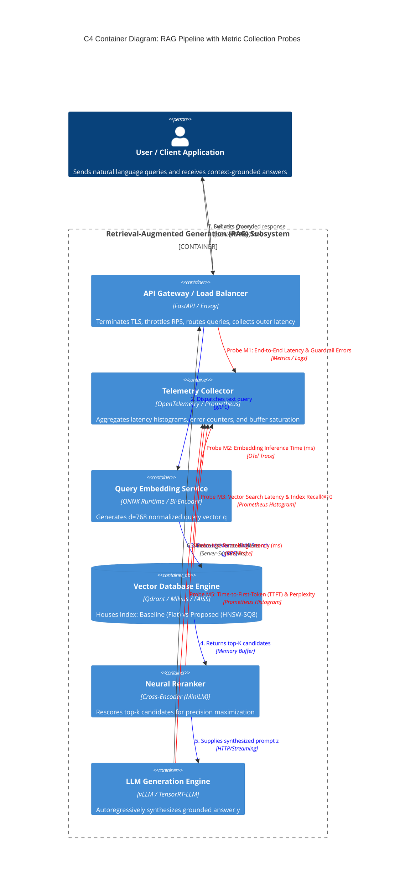

# Domain Model: Vector Databases in Retrieval-Augmented Generation (RAG)

**Authors / Research Team:**
- **Aibar Alauov** ([@alauovaibar](https://github.com/alauovaibar))
- **Balkybek Baurzhan**

**Course:** Software Engineering Research Methods — TASK 3

## 1. Executive Summary & Domain Scope

In modern Retrieval-Augmented Generation (RAG) architectures, the **Vector Database (Vector DB)** acts as the core knowledge retrieval subsystem. As enterprise RAG pipelines scale to handle high-concurrency workloads, the choice of the underlying vector indexing structure introduces fundamental trade-offs between **query latency**, **search recall (accuracy)**, and **system stability (guardrail SLA compliance)**.

This document formally specifies:
1. **Machine Learning / Mathematical Formalization (ML Track)**: Loss functions, vector similarity geometries, graph-based Approximate Nearest Neighbor (ANN) formulations, information retrieval target metrics, and operational guardrails.
2. **Software Engineering Formalization (SE Track)**: A C4 Model Component/Container Architecture diagram rendered in Mermaid format, explicitly highlighting telemetry probes and metric collection points across the retrieval-augmented pipeline.

---

## 2. Mathematical Formalization (ML / AI Track)

### 2.1 Dense Representation & Vector Embedding

Let $\mathcal{C} = \{c_1, c_2, \dots, c_N\}$ denote a corpus of $N$ text chunks. An embedding model $E_D: \mathcal{C} \to \mathbb{R}^d$ projects each textual chunk into a $d$-dimensional normalized dense vector space:

$$\mathbf{d}_i = \frac{E_D(c_i; \theta_D)}{\|E_D(c_i; \theta_D)\|_2} \in \mathbb{S}^{d-1}$$

Given an incoming user query $x \in \mathcal{X}$, a query encoder $E_Q: \mathcal{X} \to \mathbb{R}^d$ maps the query into the identical latent space:

$$\mathbf{q} = \frac{E_Q(x; \theta_Q)}{\|E_Q(x; \theta_Q)\|_2} \in \mathbb{S}^{d-1}$$

The vector similarity metric $\text{sim}(\mathbf{q}, \mathbf{d}_i)$ is defined as the inner dot product (equivalent to Cosine Similarity under $\ell_2$-normalization):

$$\text{sim}(\mathbf{q}, \mathbf{d}_i) = \langle \mathbf{q}, \mathbf{d}_i \rangle = \sum_{j=1}^d q_j \cdot d_{i,j}$$

The exact top-$k$ nearest neighbor retrieval problem is formulated as finding the subset $\mathcal{D}^*_k \subset \mathcal{C}$ of cardinality $k$ that maximizes similarity:

$$\mathcal{D}^*_k = \underset{\mathcal{S} \subset \mathcal{C}, |\mathcal{S}| = k}{\arg\max} \sum_{c_i \in \mathcal{S}} \text{sim}(\mathbf{q}, \mathbf{d}_i)$$

---

### 2.2 Indexing Architectures: Baseline vs. Proposed Solution

#### 2.2.1 Baseline Architecture: Exact Exhaustive Search (Flat Index)
The baseline system evaluates brute-force linear scanning across all $N$ vectors:

$$\tau_{\text{Flat}} = \mathcal{O}(N \cdot d)$$

While guaranteeing optimal recall ($\text{Recall} = 1.0$), computational cost and memory bandwidth scale linearly with corpus size and degrade catastrophically under high client concurrency due to CPU/GPU core saturation.

#### 2.2.2 Proposed Architecture: Hierarchical Navigable Small World (HNSW) with Scalar Quantization (SQ8)
The proposed solution replaces exhaustive linear scanning with a multi-layer graph topology $\mathcal{G} = \{\mathcal{G}_0, \mathcal{G}_1, \dots, \mathcal{G}_{L-1}\}$, where layer $l$ contains a subset of vertices $\mathcal{V}_l \subseteq \mathcal{V}_{l-1}$. The probability that a vector is inserted into layer $l$ follows an exponential decay distribution:

$$P(l) = \exp(-l \cdot m_L), \quad m_L = \frac{1}{\ln(M)}$$

where $M$ denotes the maximum number of bidirectional connections per node.

To reduce memory footprint by $75\%$ and maximize L3 CPU cache locality, 32-bit floating point vectors are compressed into 8-bit unsigned integers via affine Scalar Quantization (SQ8):

$$\tilde{d}_{i,j} = \left\lfloor \frac{d_{i,j} - d_{\min, j}}{d_{\max, j} - d_{\min, j}} \cdot 255 \right\rceil, \quad \tilde{d}_{i,j} \in \{0, 1, \dots, 255\}$$

Search traversal within layer $l$ executes greedy routing: at current node $v \in \mathcal{V}_l$, the algorithm navigates to neighbor $u \in \mathcal{N}(v)$ that minimizes metric distance:

$$u^* = \underset{u \in \mathcal{N}(v) \cup \{v\}}{\arg\min} \ \text{dist}(\mathbf{q}, \tilde{\mathbf{d}}_u)$$

The theoretical search complexity reduces from linear to logarithmic:

$$\tau_{\text{HNSW}} = \mathcal{O}(\log N \cdot d)$$

---

### 2.3 RAG End-to-End Generation Loss

In an end-to-end RAG architecture, the retrieved top-$k$ documents $\mathcal{D}_k = \{c_{(1)}, \dots, c_{(k)}\}$ are prepended to query $x$ to form the augmented context prompt $\mathbf{z} = [c_{(1)}; \dots; c_{(k)}; x]$. The autoregressive language generator $G_{\phi}$ generates response sequence $y = (y_1, y_2, \dots, y_T)$. The generation loss function $\mathcal{L}_{\text{RAG}}(\phi)$ is the negative log-likelihood:

$$\mathcal{L}_{\text{RAG}}(\phi; x, \mathcal{D}_k, y) = -\sum_{t=1}^T \log P_{\phi}\left(y_t \mid y_{<t}, \mathbf{z}\right)$$

---

### 2.4 Target Retrieval Metrics

To assess retrieval fidelity, the following scientific metrics are tracked:

1. **Recall at $k$ ($\text{Recall}@k$)**:
   $$\text{Recall}@k = \frac{|\mathcal{D}_k \cap \mathcal{R}_x|}{|\mathcal{R}_x|}$$
   where $\mathcal{R}_x$ is the ground-truth set of relevant documents for query $x$.

2. **Mean Reciprocal Rank ($\text{MRR}$)**:
   $$\text{MRR} = \frac{1}{|Q|} \sum_{i=1}^{|Q|} \frac{1}{\text{rank}_i}$$
   where $\text{rank}_i$ is the position of the first relevant document for query $q_i$.

3. **Normalized Discounted Cumulative Gain ($\text{NDCG}@k$)**:
   $$\text{DCG}@k = \sum_{i=1}^k \frac{2^{rel_i} - 1}{\log_2(i + 1)}, \quad \text{NDCG}@k = \frac{\text{DCG}@k}{\text{IDCG}@k}$$

---

### 2.5 Guardrail Metrics & SLA Constraints

In production enterprise deployments, low latency is meaningless if service level agreements (SLAs) are breached or requests drop due to thread pool exhaustion. We formalize two critical **Guardrail Metrics**:

1. **System Error Rate ($E_{\text{rate}}$)**:
   $$E_{\text{rate}} = \frac{N_{\text{HTTP\_5xx}} + N_{\text{Timeout}} + N_{\text{CircuitBreaker}}}{N_{\text{total}}} \times 100\% \quad [\text{Constraint: } E_{\text{rate}} \le 1.0\%]$$

2. **SLA Latency Violation Rate ($\text{SLA}_{\text{violation}}$)**:
   $$\text{SLA}_{\text{violation}} = \frac{1}{N_{\text{total}}} \sum_{i=1}^{N_{\text{total}}} \mathbb{I}\left(\tau_i > \tau_{\text{SLA}}\right) \times 100\% \quad [\text{Constraint: } \text{SLA}_{\text{violation}} \le 5.0\%]$$
   where $\tau_i$ is the end-to-end query latency of request $i$, and $\tau_{\text{SLA}} = 200\text{ ms}$ represents the maximum acceptable threshold for interactive human-in-the-loop retrieval.

---

### 2.6 Comprehensive Mathematical Notation Table

| Notation | Dimension / Type | Formal Definition | Domain Interpretation |
| :--- | :--- | :--- | :--- |
| $\mathcal{C}$ | Set of strings | $\mathcal{C} = \{c_1, \dots, c_N\}, |\mathcal{C}| = N$ | Document chunk corpus |
| $d$ | $\mathbb{N}^+$ | $d \in \{384, 768, 1536\}$ | Embedding vector dimensionality |
| $\mathbf{q}$ | $\mathbb{R}^d, \|\mathbf{q}\|_2 = 1$ | $E_Q(x; \theta_Q)$ | Normalized query dense embedding |
| $\mathbf{d}_i$ | $\mathbb{R}^d, \|\mathbf{d}_i\|_2 = 1$ | $E_D(c_i; \theta_D)$ | Normalized chunk dense embedding |
| $\text{sim}(\mathbf{q}, \mathbf{d}_i)$ | $[-1.0, 1.0]$ | $\langle \mathbf{q}, \mathbf{d}_i \rangle$ | Cosine semantic similarity score |
| $M$ | $\mathbb{N}^+$ | $M \in [16, 64]$ | Max bi-directional connections per HNSW node |
| $efSearch$ | $\mathbb{N}^+$ | Dynamic beam size | Size of candidate nearest neighbors queue during HNSW search |
| $\tilde{\mathbf{d}}$ | $\{0, \dots, 255\}^d$ | $\text{Quantize}_{8\text{bit}}(\mathbf{d})$ | SQ8 scalar-quantized chunk representation |
| $k$ | $\mathbb{N}^+$ | $k \in \{5, 10, 20\}$ | Number of retrieved top document chunks |
| $\mathcal{L}_{\text{RAG}}$ | $\mathbb{R}^+$ | $-\sum \log P_{\phi}(y_t \mid y_{<t}, \mathbf{z})$ | RAG generation negative log-likelihood loss |
| $\tau$ | $\mathbb{R}^+$ | Milliseconds (ms) | End-to-end query service latency |
| $\tau_{\text{SLA}}$ | $\mathbb{R}^+$ | $\tau_{\text{SLA}} = 200\text{ ms}$ | Strict Service Level Agreement upper bound |
| $E_{\text{rate}}$ | $[0.0, 100.0]\%$ | $\frac{N_{\text{failed}}}{N_{\text{total}}} \times 100$ | Guardrail metric: System error rate |

---

## 3. Software Engineering Formalization (SE Track)

### 3.1 C4 Container Diagram with Telemetry Metric Collection Probes

The diagram below specifies the end-to-end RAG architecture with explicit telemetry probes ($\mathbf{M}_1, \mathbf{M}_2, \mathbf{M}_3, \mathbf{M}_4, \mathbf{M}_5$) capturing raw metrics during benchmark execution.

### 3.2 Metric Collection Probe Registry

| Probe ID | Architecture Node | Physical Unit | Sampling Frequency | Description & Scientific Purpose |
| :--- | :--- | :--- | :--- | :--- |
| **Probe $\mathbf{M}_1$** | API Gateway | Milliseconds ($\text{ms}$), Status Code | 100% of incoming requests | Measures overall round-trip time $\tau_{\text{E2E}}$ and monitors Guardrail error rate $E_{\text{rate}}$. |
| **Probe $\mathbf{M}_2$** | Embedding Service | Milliseconds ($\text{ms}$), Flops | 100% of incoming requests | Tracks dense bi-encoder forward pass duration and detects GPU memory queuing latency. |
| **Probe $\mathbf{M}_3$** | Vector DB Engine | Milliseconds ($\text{ms}$), Ratio $[0, 1]$ | Per vector query execution | Core benchmark point: measures index search latency $\tau_{\text{index}}$ and search fidelity ($\text{Recall}@10$). |
| **Probe $\mathbf{M}_4$** | Neural Reranker | Milliseconds ($\text{ms}$) | Per candidate set | Measures cross-encoder rescoring time over candidate pool. |
| **Probe $\mathbf{M}_5$** | LLM Engine | Milliseconds ($\text{ms}$), Tokens/sec | Per response stream | Tracks Time-to-First-Token (TTFT) and token generation throughput. |
